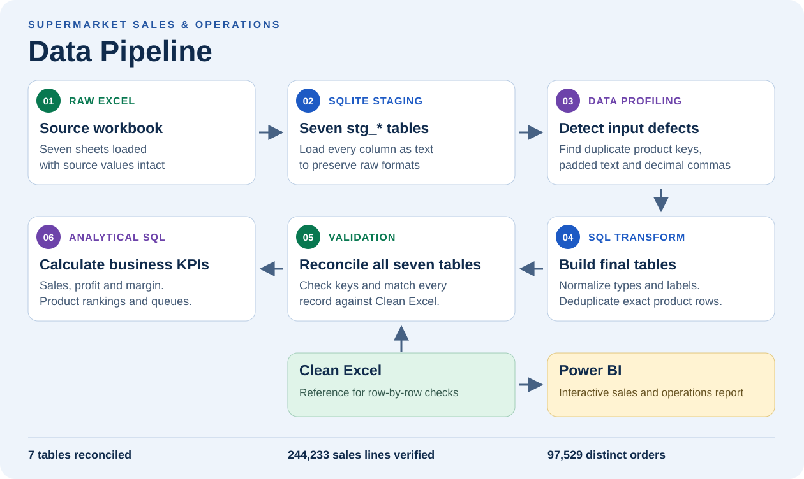
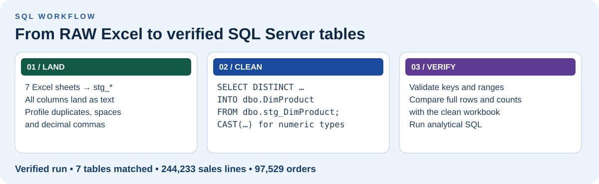
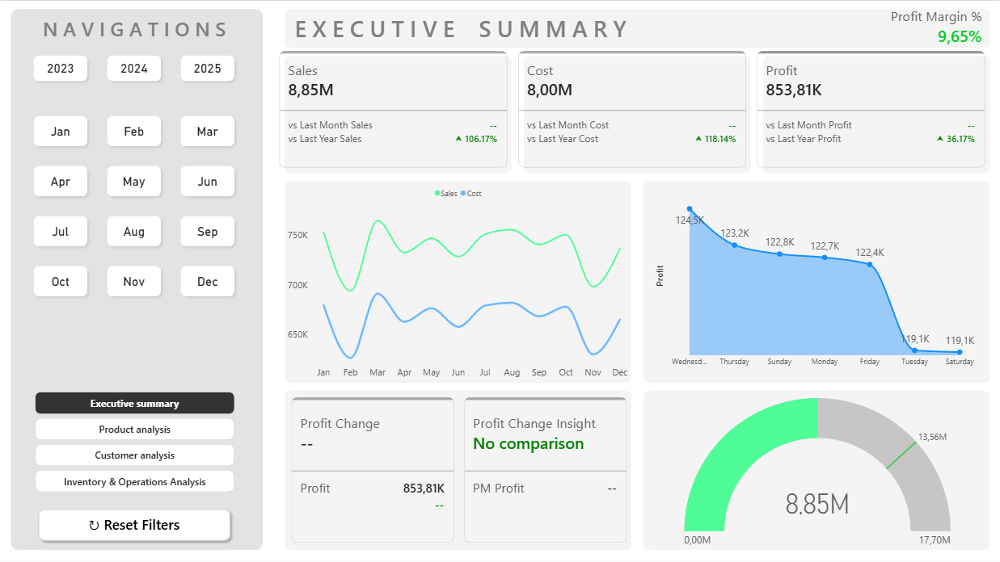
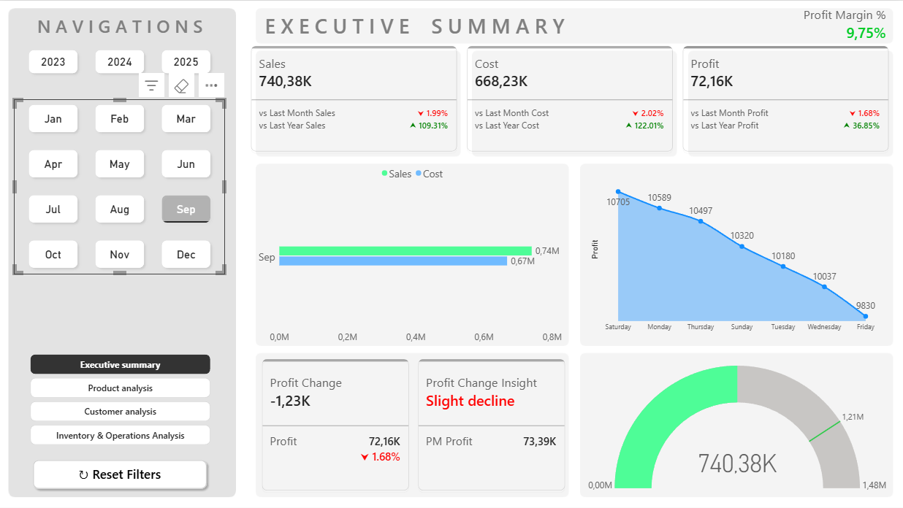
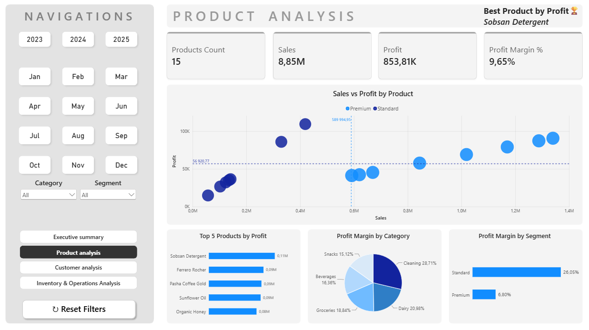
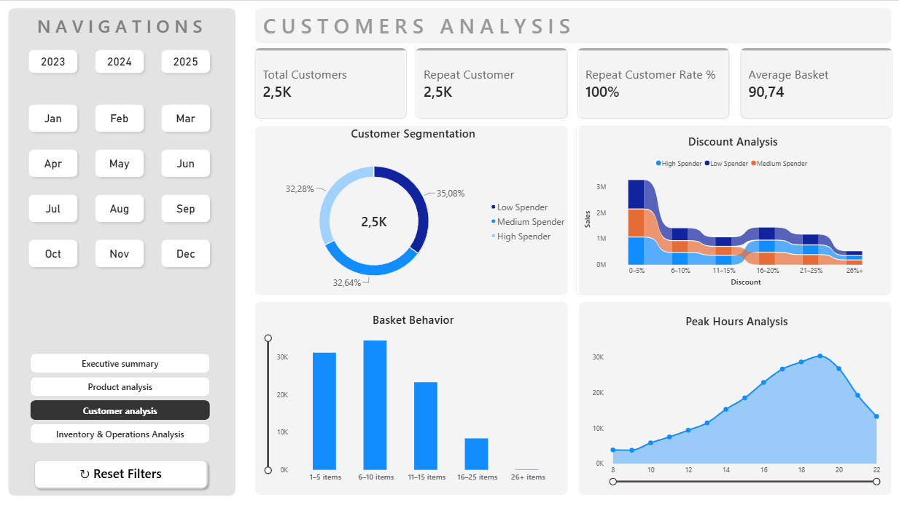
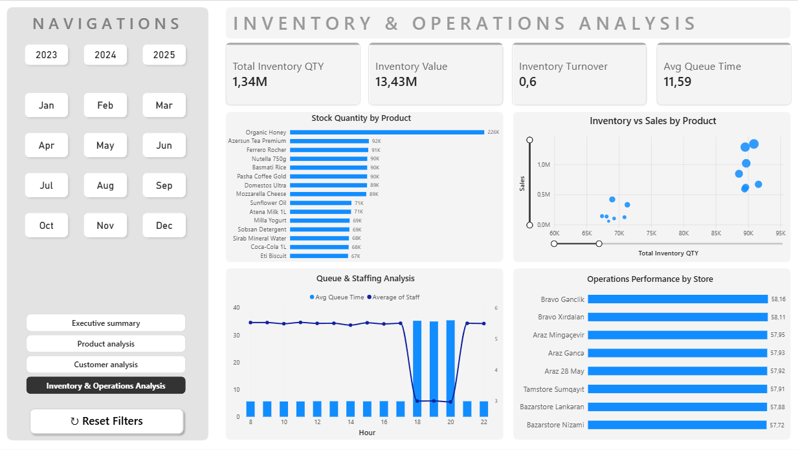
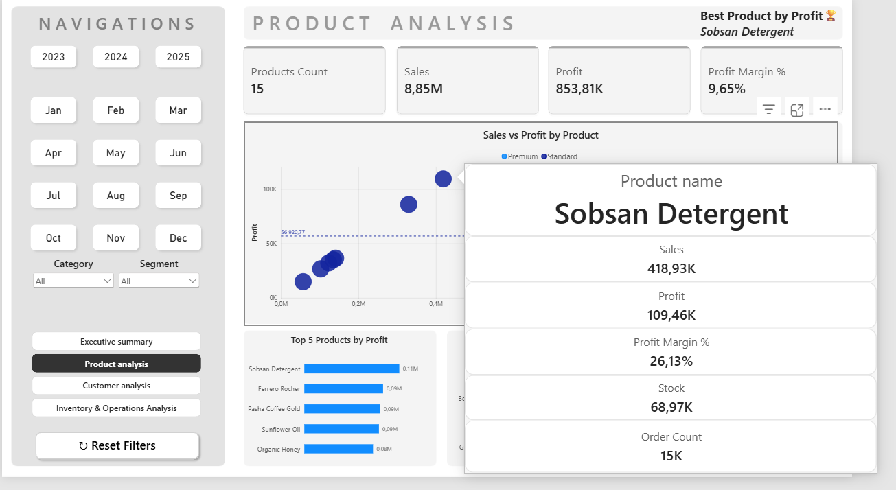
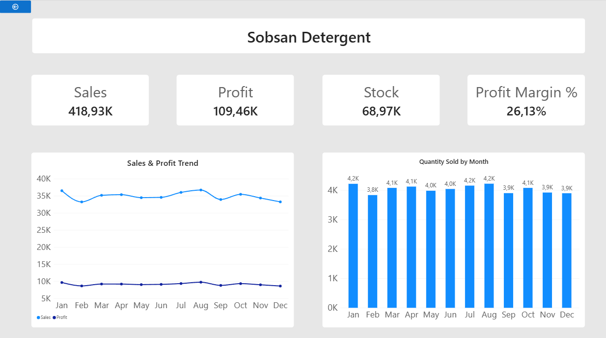

# Supermarket Sales & Operations Analytics

  

[Data pipeline](#data-preparation-and-sql) · [SQL walkthrough](#sql-walkthrough) · [Power BI screenshots](#power-bi-report)

This project brings sales, customer behavior, inventory and store operations into one Power BI report. It helps answer which products earn the most profit, how results change by month, and when queue times warrant a closer look at staffing.

[Download the Power BI report](power-bi/Supermarket_Sales_Analysis.pbix) · [Clean workbook](data/Supermarket_Sales_Clean.xlsx) · [RAW workbook](data/Supermarket_Sales_RAW.xlsx)

## Data preparation and SQL

[](screenshots/data-pipeline-overview.svg)

The RAW workbook is derived from the supplied clean workbook. We used it to build and verify an end-to-end cleaning workflow. The input contains sales lines, inventory records and hourly operations observations, supported by date, store, product and customer dimensions.

## SQL walkthrough



| Table group | Grain | Final rows |
| --- | --- | ---: |
| Date, store, product, customer | One row per dimension key | 1,096 / 8 / 15 / 2,500 |
| Sales | One line within an order | 244,233 |
| Inventory | Stock observation by date, store and product | 4,320 |
| Operations | Hourly observation by date and store | 43,800 |

1. **Load into staging.** The runner imports all seven sheets into `stg_*` tables as text. That preserves spaces, decimal commas and duplicate rows for profiling before any cast or join can hide them.
2. **Profile and clean.** [Profiling SQL](sql/01_profile.sql) finds the repeated product key and the fields with formatting defects. [Publishing SQL](sql/02_publish.sql) trims labels, normalizes decimal commas, casts quantities and costs, and removes the exact product replay. It preserves individual sales lines because an order can contain several lines. Unique dimension indexes prevent a duplicated lookup from multiplying sales in joins.
3. **Validate and reconcile.** [Validation SQL](sql/03_validate.sql) stops on missing dimension keys or invalid sales, stock or operations values. The runner compares all final records, including row multiplicities, with the supplied clean workbook.
4. **Analyze.** [Analytical SQL](sql/04_analysis.sql) computes net sales, cost, profit and margin, compares profit across consecutive calendar months, ranks products by gross profit, and compares staffing and queues by hour.

🔍 The profiling query finds product keys that appear more than once.

```sql
SELECT ProductID, COUNT(*) AS occurrences
FROM dbo.stg_DimProduct
GROUP BY ProductID
HAVING COUNT(*) > 1;
```

This returned product key `1` twice. The publish step collapses identical normalized product rows, then a unique index rejects any remaining duplicate key. If rows share a key but disagree on product attributes, that index surfaces the conflict. The sales table keeps its line grain throughout the load.

| Check | What it protects |
| --- | --- |
| Dimension keys exist for sales, inventory and operations | Missing lookup rows cannot silently disappear from analytical joins. |
| Quantities, prices, discounts, stock and queue values pass range checks | Invalid inputs cannot silently reach the verified output. |
| Full rows and multiplicities match the clean workbook | A lost row or a changed value is detected even when a simple count still matches. |

### Run on Microsoft SQL Server

Create a dedicated empty database on SQL Server 2017 or later. Install Python 3 and Microsoft ODBC Driver 18 for SQL Server. From the repository directory, configure the connection and start the loader. This PowerShell example uses Windows authentication and a trusted local development instance.

```powershell
python -m pip install -r requirements.txt
$env:SUPERMARKET_SQLSERVER = 'Driver={ODBC Driver 18 for SQL Server};Server=localhost;Database=SupermarketPortfolio;Trusted_Connection=yes;Encrypt=yes;TrustServerCertificate=yes'
python scripts/run_pipeline.py
```

Adjust the server and database names for your environment. The loader creates seven Unicode `dbo.stg_*` tables and runs the four T-SQL files in order. It commits the staging, final and reference tables only after the validations, full-row reconciliation and analytical queries succeed. Use a fresh database for another run.

The reconciliation matched all seven tables, including **244,233 sales lines across 97,529 orders**. Profiling found one duplicate product row, four padded product names, 35 padded quantities and 35 costs stored with a decimal comma.

| KPI | SQL result |
| --- | ---: |
| Net sales | 8,849,924.28 |
| Cost | 7,996,112.74 |
| Gross profit | 853,811.54 |
| Gross margin | 9.65% |

Sobsan Detergent led product profit at **109,463.10**. Between 18:00 and 20:00, average queues were **35–35.5 minutes** with about three staff on duty. At 17:00 and 21:00, they averaged **5.7 minutes** with about 5.5 staff. This identifies hours to investigate before changing staffing.

## Power BI report

Open the PBIX in Power BI Desktop and explore the saved data. To refresh in a different environment, inspect the Power Query source steps and update the workbook connection to your local copy.

### Executive Summary

The unfiltered view shows approximately **8.85M in sales, 853.81K in profit and a 9.65% margin**.



Selecting **September** changes the trend to a single-month comparison and updates the KPI cards. The report shows **740.38K in sales**, **72.16K in profit** and a **1.68% decline in profit** versus the prior month comparison.



### Product Analysis

The scatter plot compares sales and profit by product. Sobsan Detergent appears as the top product by profit in the report.



### Customer Analysis

Compare spending segments, discount bands, basket sizes and shopping hours.



### Inventory & Operations Analysis

Compare product stock with sales and review queues alongside staffing by hour. The visible evening queue increase identifies a period to investigate.



### Product tooltip and drill-through

Hover over a product point to see its key metrics. Drill through from the point to see sales, profit and units sold by month.




