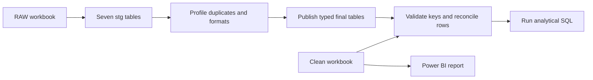

# Supermarket Sales & Operations Analytics

This project brings sales, customer behavior, inventory and store operations into one Power BI report. It helps answer which products earn the most profit, how results change by month, and when queue times warrant a closer look at staffing.

[Download the Power BI report](power-bi/Supermarket_Sales_Analysis.pbix) · [Clean workbook](data/Supermarket_Sales_Clean.xlsx) · [RAW workbook](data/Supermarket_Sales_RAW.xlsx)

## Data preparation and SQL

The RAW workbook is derived from the supplied clean workbook. We used it to build and verify an end-to-end cleaning workflow. The input contains sales lines, inventory records and hourly operations observations, supported by date, store, product and customer dimensions.

1. **Load into staging.** The runner imports all seven sheets into `stg_*` tables as text. That preserves spaces, decimal commas and duplicate rows for profiling before any cast or join can hide them.
2. **Profile and clean.** [Profiling SQL](sql/01_profile.sql) finds the repeated product key and the fields with formatting defects. [Publishing SQL](sql/02_publish.sql) trims labels, normalizes decimal commas, casts quantities and costs, and removes the exact product replay. It preserves individual sales lines because an order can contain several lines. Unique dimension indexes prevent a duplicated lookup from multiplying sales in joins.
3. **Validate and reconcile.** [Validation SQL](sql/03_validate.sql) stops on missing dimension keys or invalid sales, stock or operations values. The runner compares all final records, including row multiplicities, with the supplied clean workbook.
4. **Analyze.** [Analytical SQL](sql/04_analysis.sql) computes net sales, cost, profit and margin, compares profit across consecutive calendar months, ranks products by gross profit, and compares staffing and queues by hour.

Run `python run_pipeline.py` from the repository directory with Python 3. SQLite is included with Python and the runner uses an in-memory database.

The reconciliation matched all seven tables, including **244,233 sales lines across 97,529 orders**. Profiling found one duplicate product row, four padded product names, 35 padded quantities and 35 costs stored with a decimal comma.

| KPI | SQL result |
| --- | ---: |
| Net sales | 8,849,924.28 |
| Cost | 7,996,112.74 |
| Gross profit | 853,811.54 |
| Gross margin | 9.65% |

Sobsan Detergent led product profit at **109,463.10**. Between 18:00 and 20:00, average queues were **35–35.5 minutes** with about three staff on duty. At 17:00 and 21:00, they averaged **5.7 minutes** with about 5.5 staff. This identifies hours to investigate before changing staffing.

## Power BI report

Open the PBIX in Power BI Desktop and explore the saved data. To refresh in a different environment, inspect the Power Query source steps and update the workbook connection to your local copy.

### Executive Summary

The unfiltered view shows approximately **8.85M in sales, 853.81K in profit and a 9.65% margin**.

Selecting **September** changes the trend to a single-month comparison and updates the KPI cards. The report shows **740.38K in sales**, **72.16K in profit** and a **1.68% decline in profit** versus the prior month comparison.

### Product Analysis

The scatter plot compares sales and profit by product. Sobsan Detergent appears as the top product by profit in the report.

### Customer Analysis

Compare spending segments, discount bands, basket sizes and shopping hours.

### Inventory & Operations Analysis

Compare product stock with sales and review queues alongside staffing by hour. The visible evening queue increase identifies a period to investigate.

### Product tooltip and drill-through

Hover over a product point to see its key metrics. Drill through from the point to see sales, profit and units sold by month.

